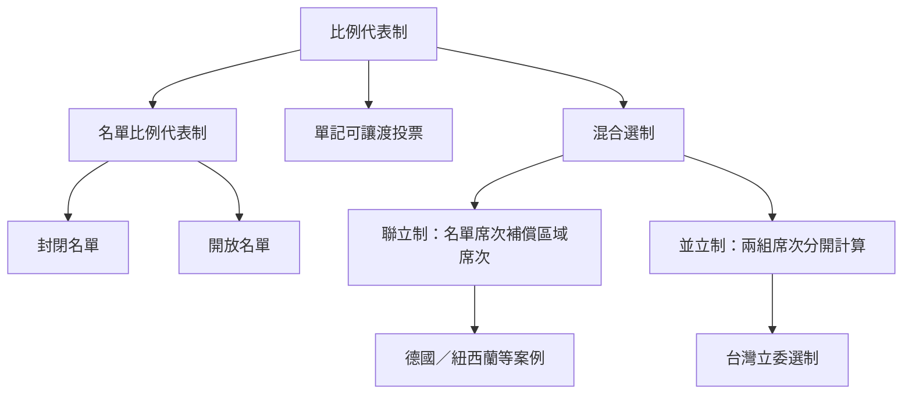

本圖先區分名單比例代表制、STV 與混合選制，再以席次是否互相補償辨認聯立制與並立制。制度名稱相似，不代表票席轉換規則相同。

**概念與案例：** [[比例代表制]]、[[名單比例代表制]]、[[封閉名單]]、[[開放名單]]、[[單記可讓渡投票]]、[[聯立制]]、[[並立制]]、[[混合選制]]、[[台灣立委選舉是區域席次與不分區名單並立]]、[[紐西蘭聯立制以政黨票決定國會總席次]]、[[德國2025年聯邦選舉以第二票決定政黨席次總額]]

**主題導讀：** [[Proportional_representation|《比例代表制：選票如何轉化為多元而可問責的政治代表》]]。
