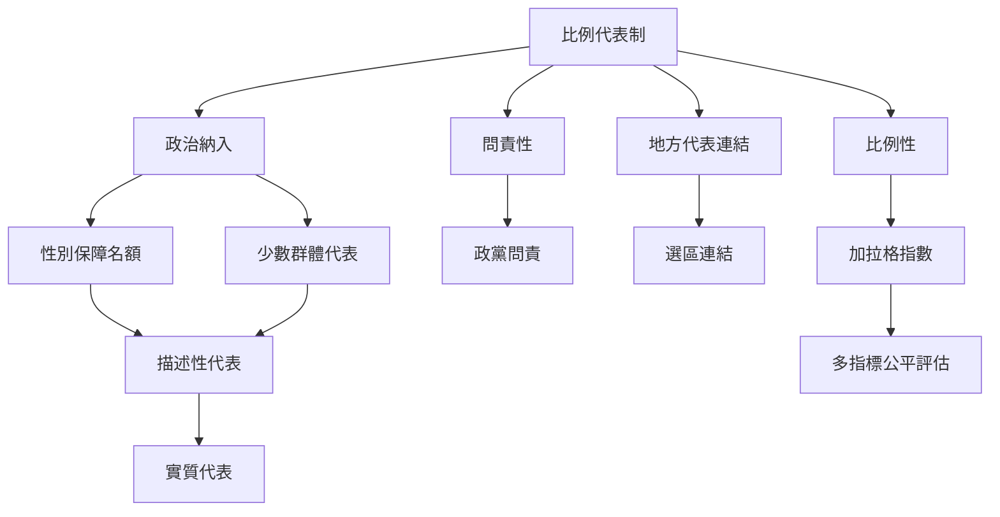

比例性只是民主代表的一個面向。本圖把席次分布連接到政黨問責、地方連結、性別與族群代表，以及政策影響，提醒研究者避免以單一指標定義制度品質。

**概念與案例：** [[比例代表制]]、[[性別保障名額]]、[[描述性代表]]、[[實質代表]]、[[有效政黨數]]、[[聯合政府]]、[[地方代表連結]]、[[小黨代表性]]、[[加拉格指數]]、[[比例性與問責性需要分開測量]]、[[比例代表制不會自然消除權力不平等]]、[[選舉公平需同時考慮選票席次和政策影響]]

**主題導讀：** [[Proportional_representation|《比例代表制：選票如何轉化為多元而可問責的政治代表》]]。
