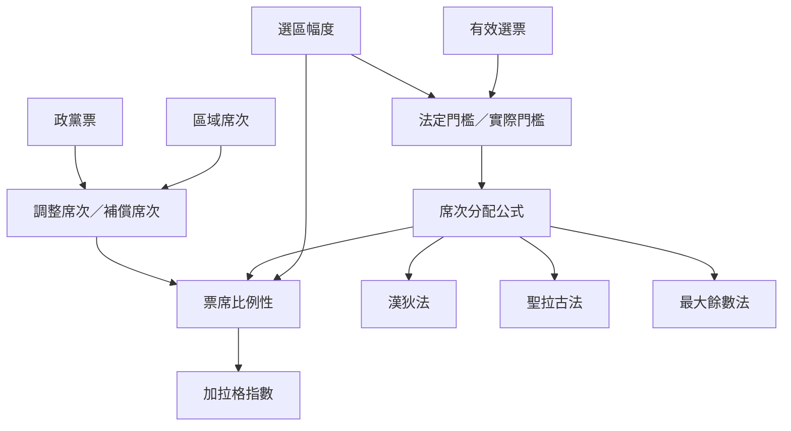

本圖聚焦比例性的制度條件：選區幅度與門檻形成進入議會的障礙，分配公式決定最後席次如何在政黨間分配，調整席次則可能修正選區層級的不比例。

**概念與案例：** [[選區幅度]]、[[法定門檻]]、[[實際門檻]]、[[漢狄法]]、[[聖拉古法]]、[[最大餘數法]]、[[德魯普配額]]、[[調整席次]]、[[超額席次]]、[[加拉格指數]]、[[選區幅度會改變小黨取得席次的實際門檻]]、[[分配公式含有政治價值判斷而非純粹算術]]

**主題導讀：** [[Proportional_representation|《比例代表制：選票如何轉化為多元而可問責的政治代表》]]。
