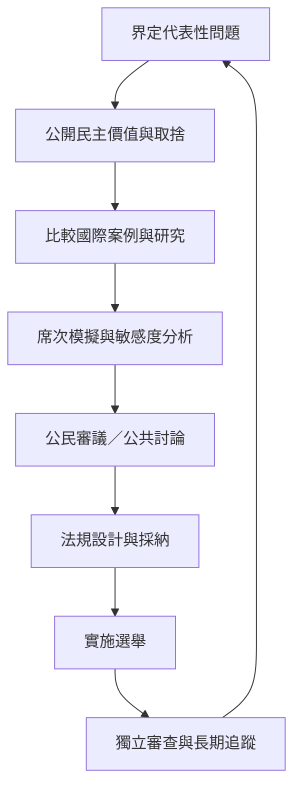

本圖將選制改革視為公共制度設計流程：先辨識價值與問題，再建立跨國證據、模擬方案、進行公民審議，最後透過選舉結果和政策表現持續評估。

**概念與案例：** [[選制改革必須先說清楚希望實現哪些民主價值]]、[[選制改革必須有公眾理解與持續審查]]、[[紐西蘭公投與獨立審查顯示選制改革可以持續修正]]、[[用台灣歷屆選舉資料模擬並立制與聯立制的差異]]、[[建立公開的票席落差與代表性儀表板]]、[[讓公民審議比較不同選制而不是只做立場表態]]、[[為選制改革製作一份可以被公民檢查的說明書]]、[[建立改制後三屆選舉的長期追蹤評估]]

**主題導讀：** [[Proportional_representation|《比例代表制：選票如何轉化為多元而可問責的政治代表》]]。
