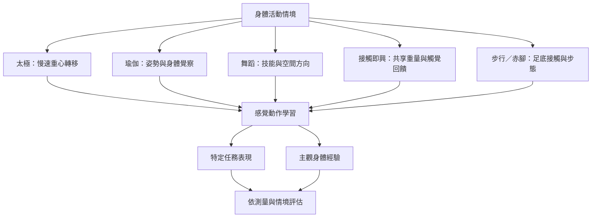

舞蹈、接觸即興、太極、瑜伽與日常步行都能提供感覺動作互動的觀察情境，但不同活動的目的、強度與研究測量不同。將它們作為探索與學習的場域，比將其一概稱為「本體感覺療法」更準確。

## Mermaid 關係圖

## 雙向連結
* 概念：[[本體感覺]]、[[具身認知]]、[[動作學習]]、[[感覺動作整合]]、[[身體覺察]]、[[足底觸覺]]。
* 永久筆記：[[舞蹈與接觸即興可作為感覺動作學習的觀察場域]]、[[觸地資訊與肌肉訊號共同支援平衡]]、[[身體控制是預測與回饋的循環]]。
* 靈感：[[赤腳生活應被理解為多感官探索而非本體感覺療法]]、[[一萬步可以轉化為觀察身體與環境互動的日常田野]]、[[接觸即興可以觀察身體如何讀取他人的重量與意圖]]、[[內觀能細化身體經驗描述但不能代替本體感覺測驗]]。
* 文獻：[[太極研究提供本體感覺訓練線索但研究結果並非完全一致]]、[[瑜伽可能提升多面向身體覺察但不能直接等同本體感覺改善]]、[[舞蹈研究呈現本體感覺在技巧與身體表徵中的多種意義]]。
