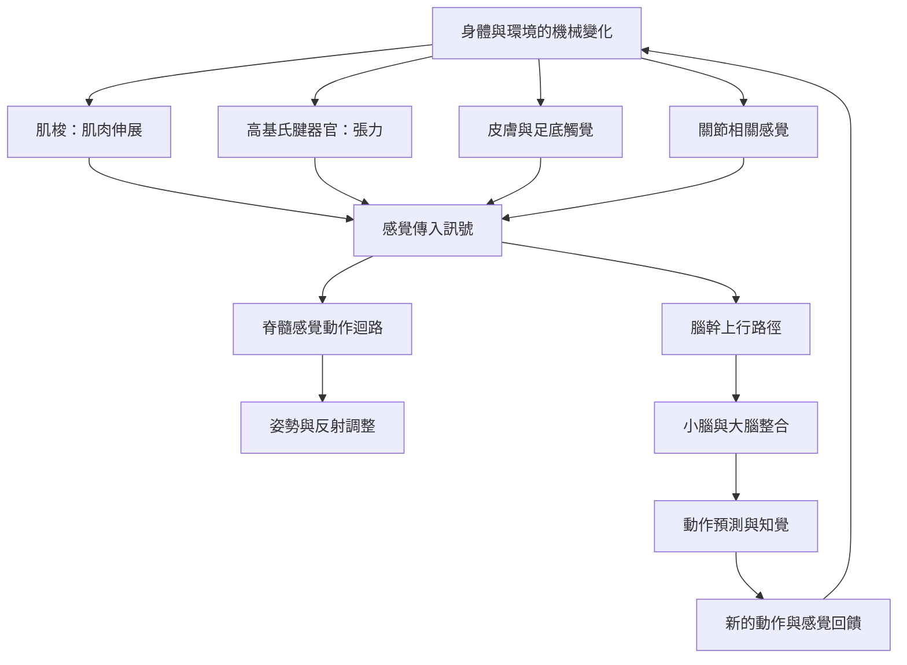

本體感覺的周邊輸入包括肌梭、腱器官、皮膚與關節相關訊號；中樞神經系統經由脊髓、腦幹、小腦與大腦路徑，將訊號整合為姿勢與動作控制所需的資訊。不同受器不是互相替代，而是提供互補且受情境調節的線索。

## Mermaid 關係圖

## 雙向連結
* 概念：[[本體感覺]]、[[肌梭]]、[[高基氏腱器官]]、[[動覺]]、[[軀體感覺]]、[[足底觸覺]]。
* 永久筆記：[[本體感覺是身體姿勢與動作的內在訊號系統]]、[[肌梭回報肌肉長度與變化速度]]、[[高基氏腱器官提供肌肉張力與力量相關資訊]]、[[本體感覺由受器群與中樞整合共同形成]]、[[身體控制是預測與回饋的循環]]。
* 文獻：[[肌肉與皮膚訊號共同構成本體感覺而非單一感受器]]、[[肌梭與高基氏腱器官提供互補的肌肉回饋]]、[[本體感覺研究正從受器分類走向細胞身分與神經迴路]]。
