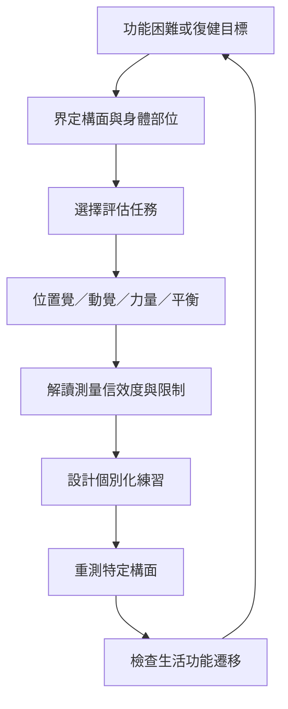

評估本體感覺時，先定義欲測量的構面、身體部位與任務條件，再選擇位置覺、動覺、力量或動態平衡等工具。復健則應以當事人重視的功能參與為目標，並檢視訓練效果是否遷移到日常活動。

## Mermaid 關係圖

## 雙向連結
* 概念：[[本體感覺]]、[[關節位置覺]]、[[動覺]]、[[心理物理測量]]、[[動作學習]]、[[神經可塑性]]。
* 永久筆記：[[本體感覺測量必須明確指定部位任務與條件]]、[[動作練習可改善特定感覺動作能力但遷移有限]]、[[復健應以功能目標而非抽象感覺分數為中心]]。
* 文獻：[[本體感覺準確度包含多種任務且沒有單一通用測量]]、[[臨床本體感覺測試各有取捨且尚缺一致標準]]、[[老年人感覺動作訓練可能改善平衡但整體證據品質偏低]]、[[最新訓練研究提醒本體感覺訓練需先明確界定目標]]。
