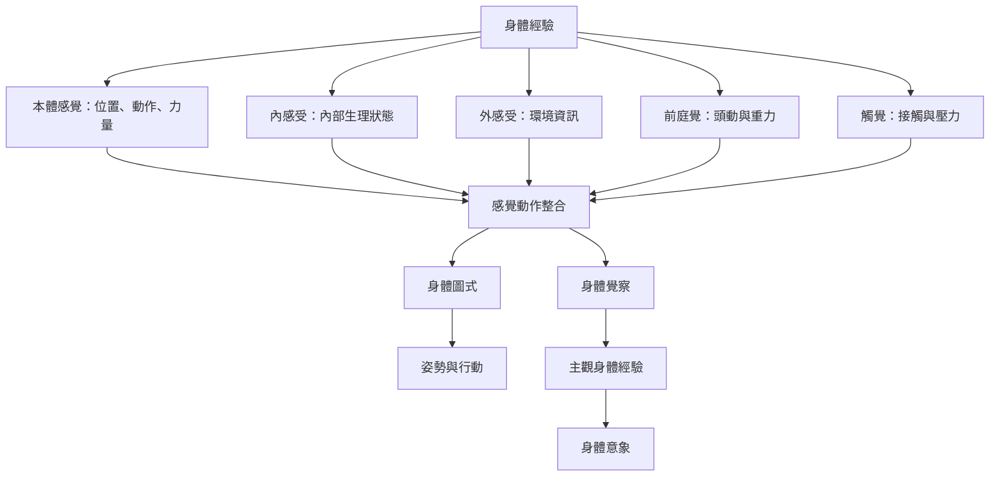

本體感覺與身體圖式、身體意象、內感受、外感受及前庭覺相互關聯，但概念上需要區分。身體圖式偏向行動導向的身體表徵；身體意象則涵蓋主觀感受與評價。多感官整合使個體在環境改變時調整對身體狀態的估計。

## Mermaid 關係圖

## 雙向連結
* 概念：[[本體感覺]]、[[內感受]]、[[外感受]]、[[前庭覺]]、[[軀體感覺]]、[[身體圖式]]、[[身體意象]]、[[身體覺察]]、[[具身認知]]、[[感覺重新加權]]。
* 永久筆記：[[內感受與本體感覺提供不同但互補的身體資訊]]、[[身體圖式是行動導向的身體表徵]]、[[身體覺察不是本體感覺的同義詞]]、[[視覺可以補償本體感覺但無法完全取代]]、[[疼痛可能改變身體定位及感覺加權]]。
* 文獻：[[自閉症身體表徵研究增加但直接測量本體感覺的研究仍少]]、[[慢性疼痛可能改變身體表徵與多種感覺訊號的權重]]、[[瑜伽可能提升多面向身體覺察但不能直接等同本體感覺改善]]。
