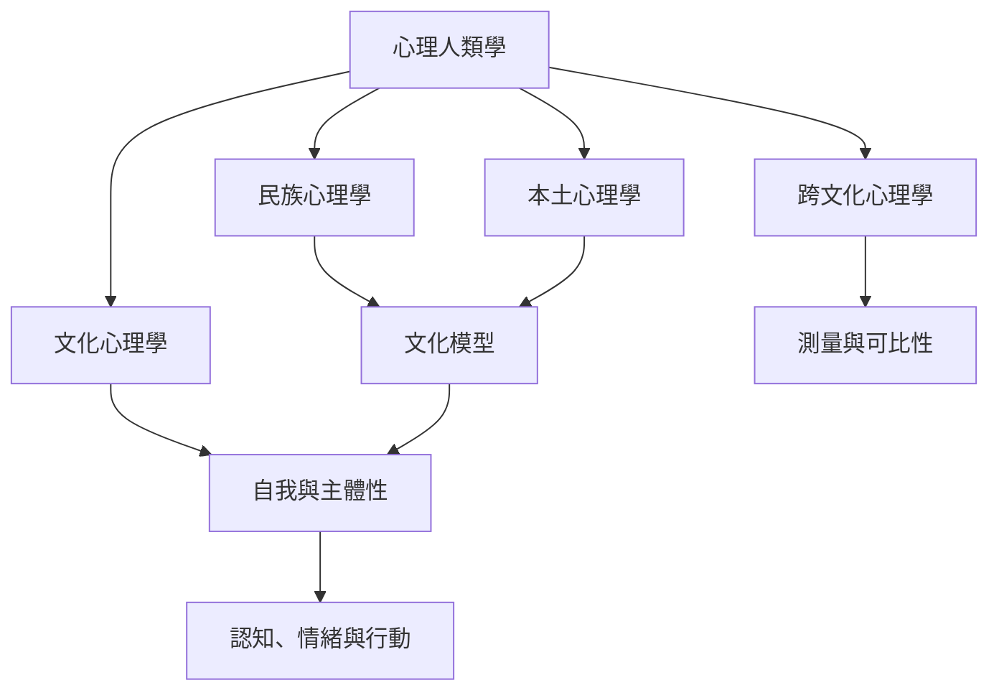

心理人類學的理論核心，是理解心理經驗如何在個體與社會文化世界的互動中形成。可從文化模型、民族心理學、自我與主體性切入，再比較文化心理學、本土心理學與跨文化心理學如何提出不同的知識主張。

連結：[[心理人類學]]、[[民族心理學]]、[[文化心理學]]、[[Ojibwa民族誌將自我放在行為環境與世界觀之中]]、[[本土心理學]]、[[跨文化心理學]]、[[文化模型]]、[[主體性]]、[[WEIRD樣本]]。
