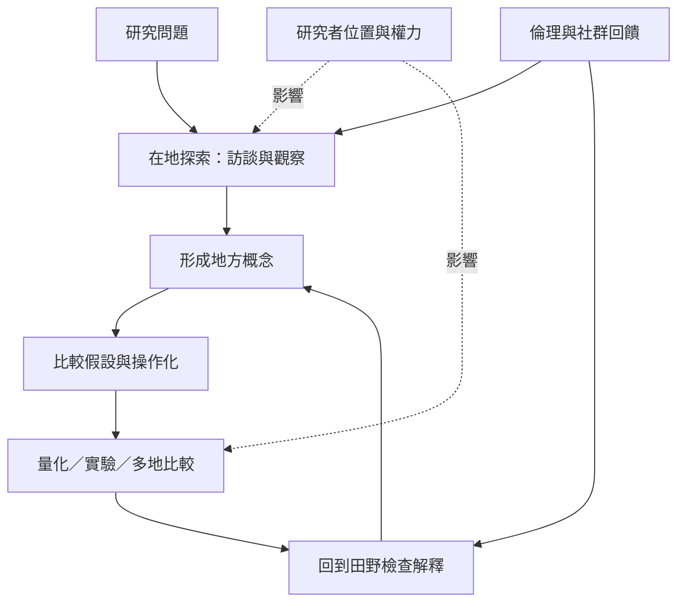

研究方法並非中立工具。訪談、參與觀察、量表、實驗與影像都會選擇性地呈現經驗；研究者必須處理翻譯、樣本、權力、再現倫理與成果回饋。最有力的設計往往讓地方概念與比較檢驗互相校正。

連結：[[跨文化比較必須先檢查樣本與概念的可比性]]、[[研究方法應讓地方概念與比較檢驗互相校正]]、[[心理研究必須把殖民歷史與制度權力納入分析]]、[[心理人類學研究小型社群時必須處理國家權力與再現倫理]]、[[民族誌]]、[[以人為中心的民族誌]]。
