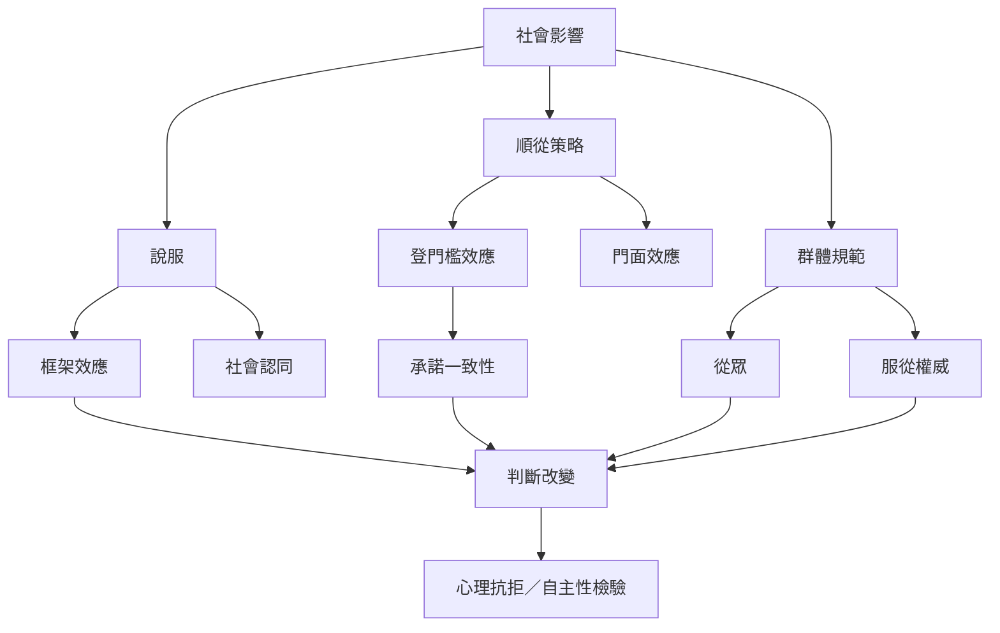

整理日常說服和順從研究：登門檻、門面效應、社會認同、權威、從眾、服從、承諾一致性與心理抗拒。這些概念描述可能的影響機制，不是保證有效的操縱配方。

## 關係圖

## 相關概念
* [[影響]]
* [[說服]]
* [[登門檻效應]]
* [[門面效應]]
* [[社會認同]]
* [[權威]]
* [[服從]]
* [[從眾]]
* [[心理抗拒]]

## 核心論點
* [[影響策略的效果取決於情境而不是固定公式]]
* [[服從權威是情境與關係共同塑造的行為]]
* [[承諾一致性可能讓人替早期的小決定持續找理由]]
