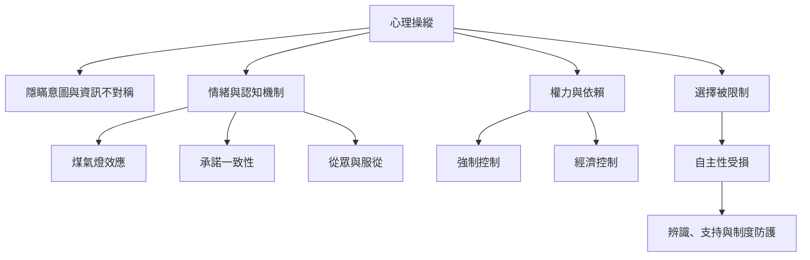

從概念邊界、心理機制、關係權力到科技設計，整理本書的總體架構。心理操縱的核心判準不是「對方讓我改變想法」，而是影響過程是否隱蔽、是否利用資訊與權力不對稱、是否削弱自由拒絕與退出。

## 關係圖

## 相關概念
* [[心理操縱]]
* [[影響]]
* [[說服]]
* [[資訊不對稱]]
* [[自主性]]
* [[退出自由]]
* [[強制控制]]

## 核心論點
* [[心理操縱會把關係品質建立在不平等的資訊與選擇上]]
* [[辨識操縱應檢視長期模式而非單句話語]]
* [[權力不對等會放大心理操縱的效果]]
* [[心理操縱會把關係品質建立在不平等的資訊與選擇上]]
