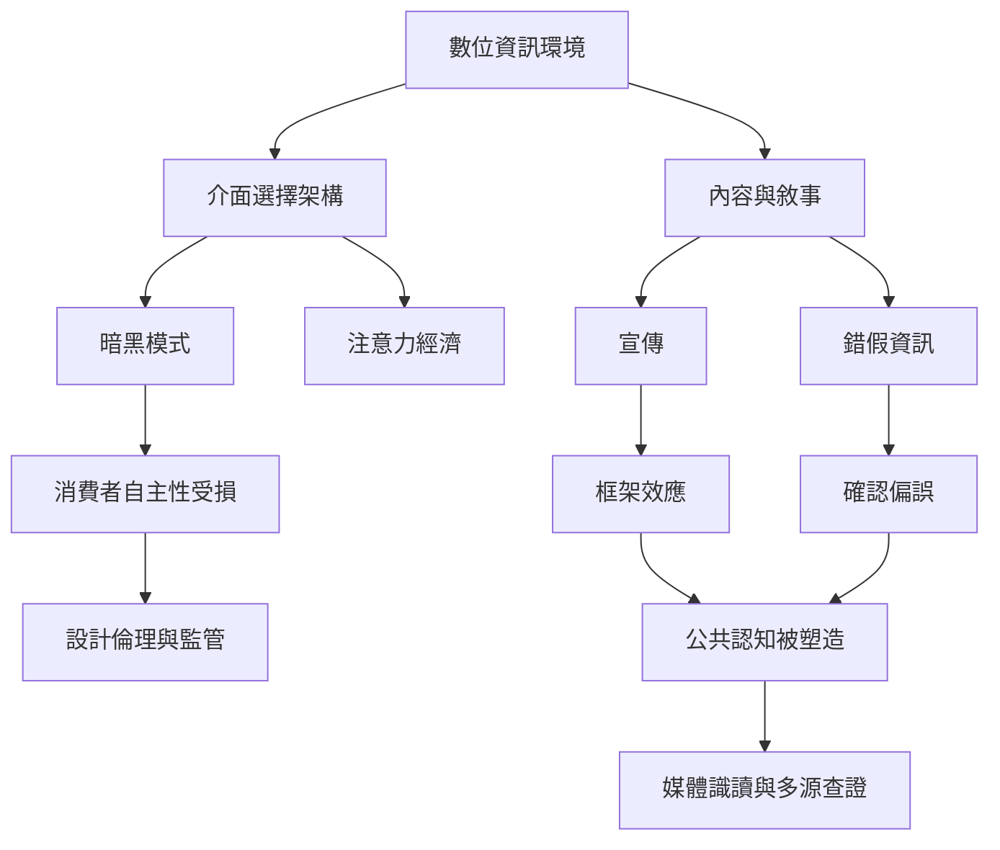

將操縱從人際互動延伸到平台和公共資訊環境。暗黑模式嵌入介面選擇，宣傳與錯假資訊影響公共敘事，媒體識讀和設計治理則提供制度層次的回應。

## 關係圖

## 相關概念
* [[暗黑模式]]
* [[注意力經濟]]
* [[宣傳]]
* [[錯假資訊]]
* [[框架效應]]
* [[確認偏誤]]
* [[媒體識讀]]
* [[自主性]]

## 核心論點
* [[數位介面能把操縱嵌入選擇架構而不必直接命令人]]
* [[政治宣傳利用框架與群體認同塑造公共現實]]
* [[設計自主性應讓拒絕與退出同樣容易]]
