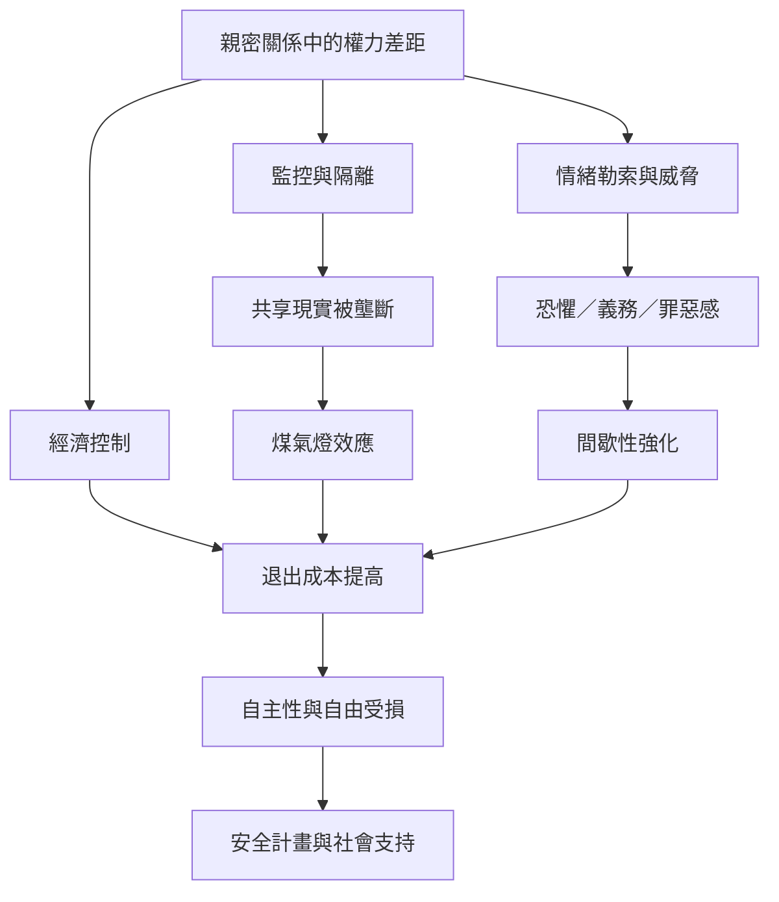

聚焦伴侶、家庭與照顧關係中的長期控制，串連 Gaslighting、情緒勒索、經濟控制、隔離與退出成本。此地圖以關係模式為分析單位，並提醒讀者安全及外部支持優先於面對面對質。

## 關係圖

## 相關概念
* [[強制控制]]
* [[煤氣燈效應]]
* [[情緒勒索]]
* [[經濟控制]]
* [[創傷依附]]
* [[間歇性強化]]
* [[社會支持]]
* [[退出自由]]

## 核心論點
* [[強制控制是一段時間內逐步縮小他人自由的行為模式]]
* [[煤氣燈效應會削弱一個人對自身知覺與記憶的信任]]
* [[間歇性獎賞可能讓不穩定關係更難退出]]
