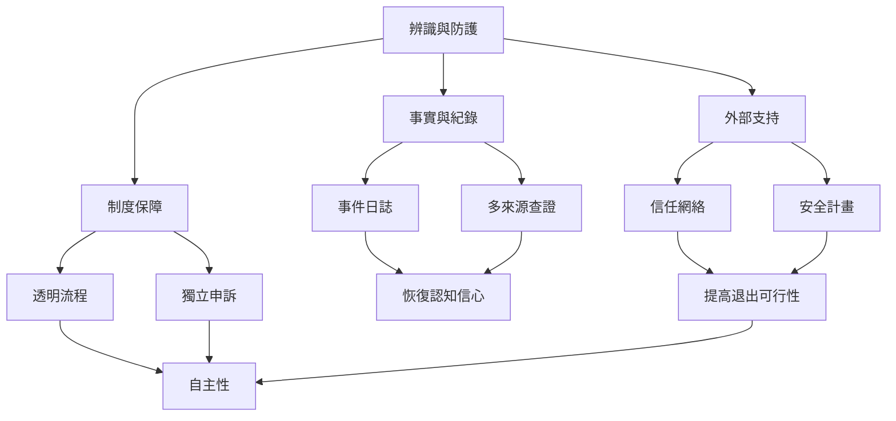

將防護策略從個人警覺延伸至關係支持與制度設計：保存事實、增加外部支持、維持拒絕與退出權、保障申訴機制，以及讓介面與組織都能被問責。

## 關係圖

## 相關概念
* [[自主性]]
* [[知情同意]]
* [[退出自由]]
* [[社會支持]]
* [[證據日誌]]
* [[媒體識讀]]
* [[非暴力溝通]]
* [[交織性]]

## 核心論點
* [[以七個問題建立日常心理操縱辨識清單]]
* [[用事件日誌保護記憶而不是陷入反覆爭辯]]
* [[互賴關係應讓每個人保有拒絕與退出的自由]]
