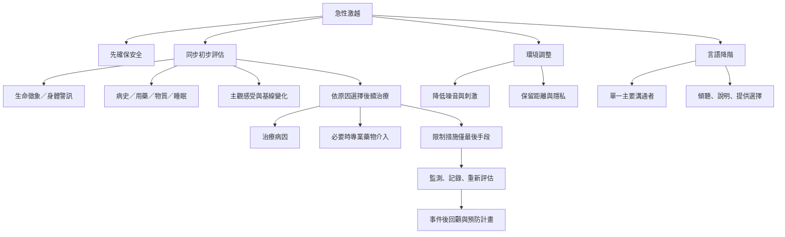

急性激越的處置同時追求即時安全、病因辨識、降低痛苦和恢復自主。評估不是單一路徑，而是同時進行的工作：確認危險、辨識身體急症、了解情境、建立溝通與追蹤變化。

## 評估層次
* 病因：[[term/Delirium|譫妄]]、[[term/Akathisia|靜坐不能]]、[[term/Catatonia|緊張症]]、[[term/Substance_intoxication_and_withdrawal|物質中毒與戒斷]]與身體疾病。
* 互動：[[term/Verbal_de_escalation|言語降階]]、[[term/共同調節|共同調節]]及[[term/Trauma_informed_care|創傷知情照護]]。
* 權利：[[term/Seclusion_and_restraint|隔離與約束]]、[[note/患者經驗應納入激越照護品質的判準|患者經驗]]與最少限制原則。

參考：Project BETA：[醫療評估](https://pmc.ncbi.nlm.nih.gov/articles/PMC3298208/)、[言語降階](https://pmc.ncbi.nlm.nih.gov/articles/PMC3298202/)、[精神藥理](https://pmc.ncbi.nlm.nih.gov/articles/PMC3298219/)；NICE NG10：[Recommendations](https://www.nice.org.uk/guidance/ng10/chapter/recommendations)。
