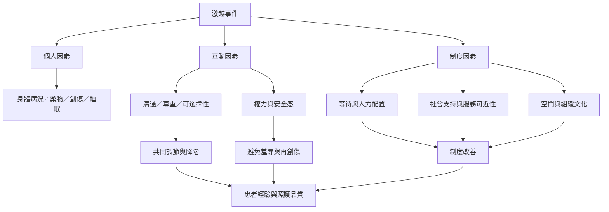

激越的照護品質不只由個別工作者的技術決定，也受制度、空間、資源、權力關係與社會不平等影響。患者中心與創傷知情的觀點，要求在維持安全之餘，也追蹤選擇、尊嚴、信任與事件後影響。

## 核心問題
* 誰有權定義當下的風險與「合作」？
* 限制措施是否真的必要、最少且最短？
* 患者是否能理解流程並參與決策？
* 事件是否暴露出服務可近性、環境或工作條件問題？

參考：[[data/急診患者訪談顯示身體約束可能留下長期傷害感|急診患者訪談顯示身體約束可能留下長期傷害感]]、[[note/急診激越同時反映個人困境與照護系統壓力|急診激越同時反映個人困境與照護系統壓力]]、[[note/患者經驗應納入激越照護品質的判準|患者經驗應納入激越照護品質的判準]]。
