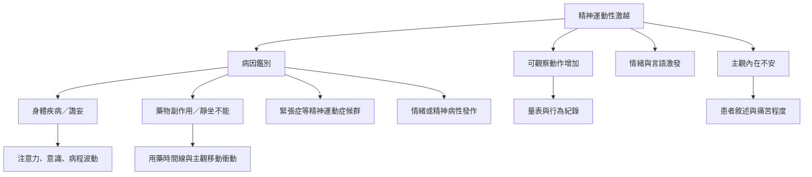

精神運動性激越是一個跨診斷的表現，需要將外在活動、內在經驗、起病時間和可能原因分開觀察。核心鑑別包括[[term/Akathisia|靜坐不能]]、[[term/Delirium|譫妄]]、[[term/Catatonia|緊張症]]、[[term/Psychomotor_retardation|精神運動遲滯]]，以及情緒發作中的精神運動變化。

閱讀此圖時，請避免把任何一條支線視為診斷結論。量表、訪談與身體評估是互補資料。

參考：[[data/精神運動性激越是跨診斷的症候表現而非單一疾病|精神運動性激越是跨診斷的症候表現而非單一疾病]]、[[note/新發激越應優先排除身體原因而非先歸咎精神疾病|新發激越應優先排除身體原因而非先歸咎精神疾病]]、[[note/靜坐不能與一般精神運動性激越不能僅憑外觀區分|靜坐不能與一般精神運動性激越不能僅憑外觀區分]]、[[note/激越的診斷必須納入緊張症與其他精神運動異常|激越的診斷必須納入緊張症與其他精神運動異常]]。
