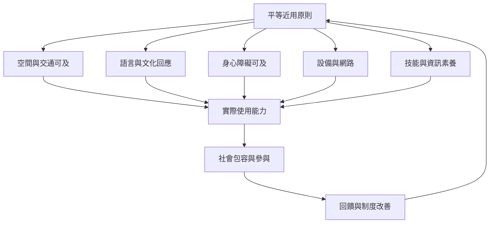

近用不是單一入口，而是從知道服務、抵達空間、理解資訊、取得協助到參與決策的一整段路徑。此地圖把經濟、語言、障礙、數位技能與制度門檻放在同一個分析框架，並將公平近用連結到通用設計與社會包容。

* 核心概念：[[社會包容]]、[[數位落差]]、[[數位包容]]、[[通用設計]]、[[文化多樣性]]。
* 實踐入口：[[公共圖書館必須把平等近用轉化成可檢驗的服務設計]]、[[以未使用者旅程找出公共圖書館真正的入口障礙]]。
