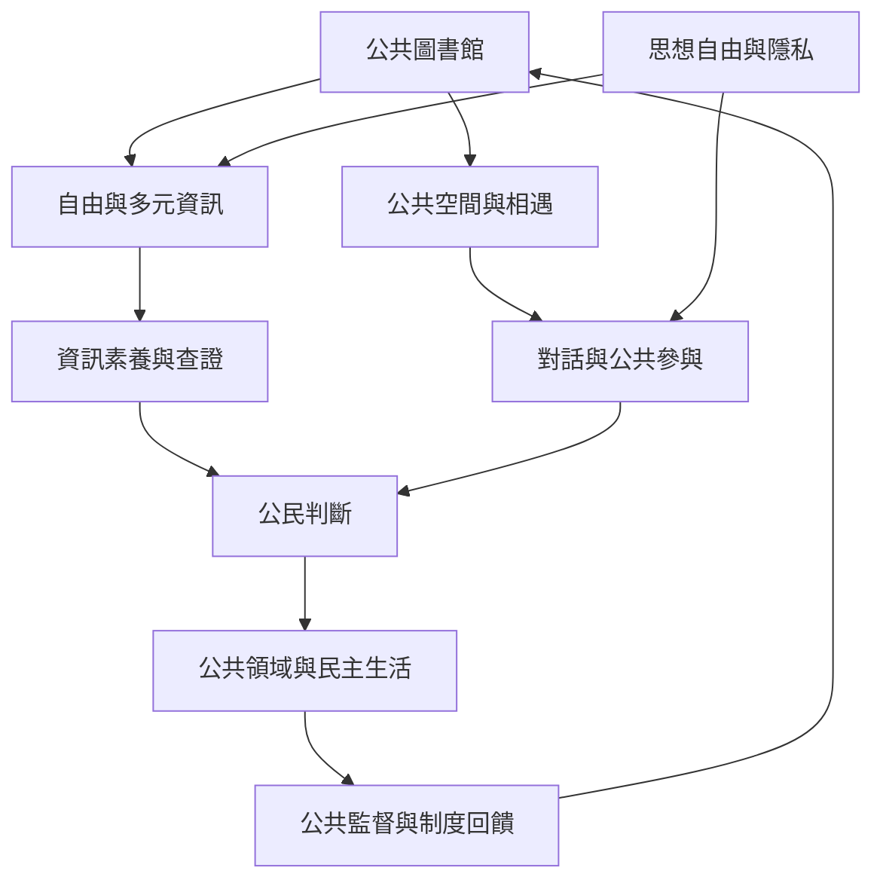

公共圖書館的民主角色不只在舉辦討論會，更在提供可查證資訊、保護閱讀自由、支援公民理解公共事務，並讓多元的人有機會共同在場。民主服務必須同時處理資訊近用、思想自由、隱私與爭議治理。

* 核心概念：[[公共領域]]、[[思想自由]]、[[資訊隱私]]、[[資訊素養]]、[[社會資本]]。
* 深入閱讀：[[公共圖書館能以資訊近用支持公民形成判斷]]、[[公共圖書館必須在專業中立與實質平等之間公開作出判斷]]。
