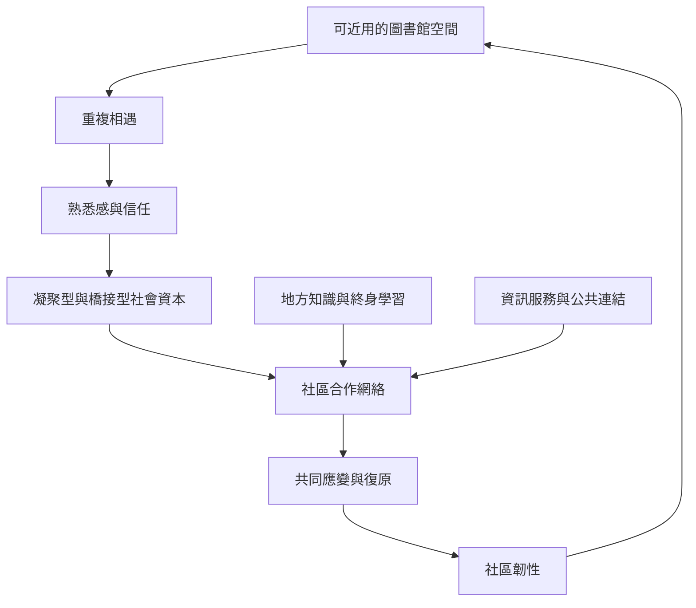

圖書館的社區作用需要時間累積：穩定空間、重複相遇、地方知識、組織合作與可靠資訊逐漸形成社會資本，並在危機時支持社區的協調與恢復。此地圖強調「平時的關係」與「危機時的能力」之間的連續性。

* 核心概念：[[社會基礎設施]]、[[第三場所]]、[[社會資本]]、[[社區韌性]]、[[社區發展]]。
* 個案：[[台灣公共圖書館能透過知識網絡與地方連結支持社區韌性]]、[[麥德林圖書館公園把閱讀教育休閒與城市公共空間結合]]。
