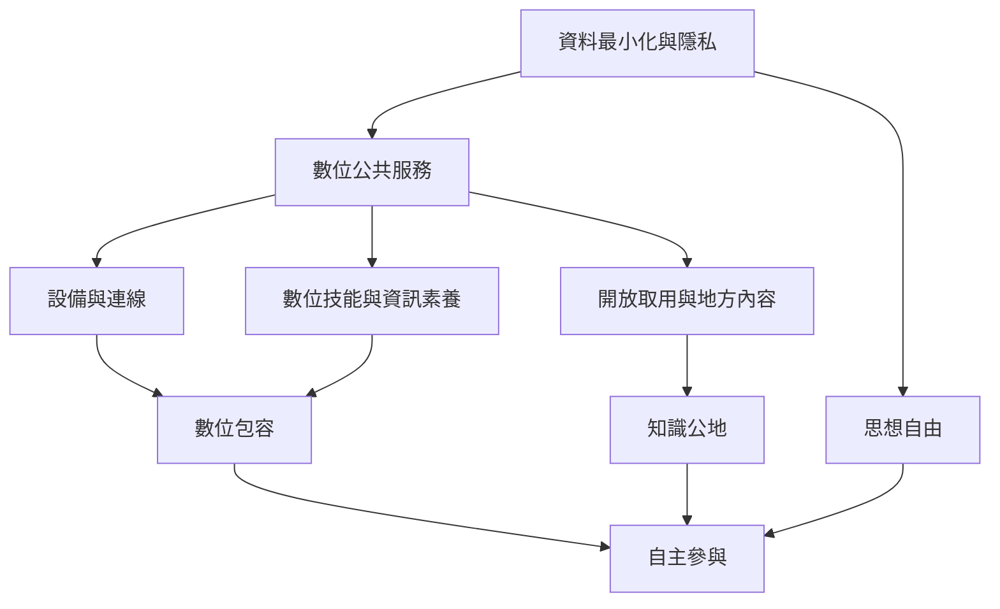

公共圖書館的數位轉型必須同時處理接取能力、資訊素養、隱私、開放知識與社群知識主權。只追求技術導入可能增加監控與排除；好的數位服務應讓讀者保有自主、理解風險，並能參與地方知識的保存與治理。

* 核心概念：[[數位包容]]、[[資訊素養]]、[[資訊隱私]]、[[開放取用]]、[[知識公地]]。
* 實踐入口：[[替圖書館建立一份讀者資料最小化檢查清單]]、[[把數位協助設計成陪伴而非替使用者代辦]]。
