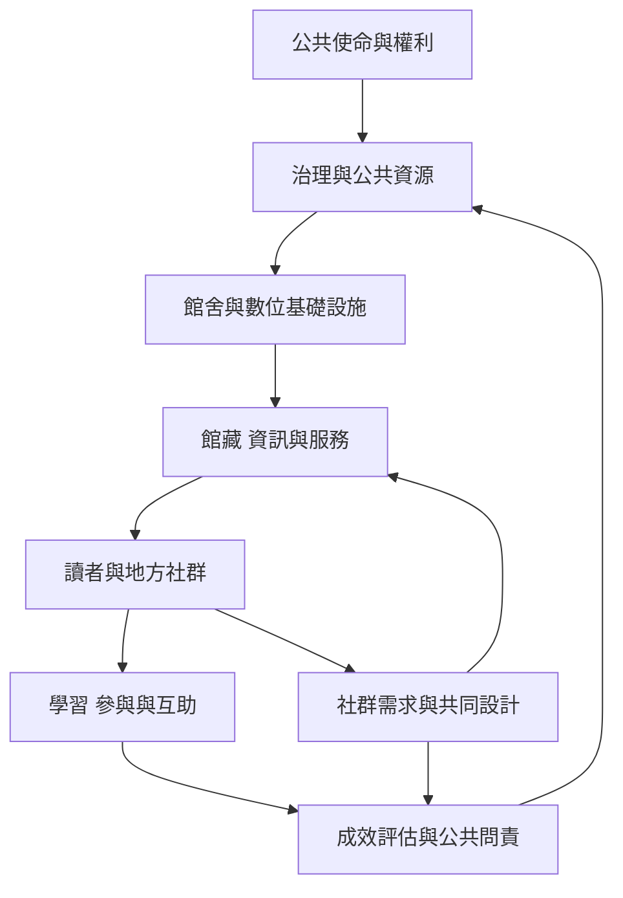

公共圖書館是一套由公共價值、治理制度、資源、服務與社群關係組成的系統。它不只是館舍與館藏；公共經費、地方決策、專業人員、空間設計及社群合作共同決定誰能取得知識與參與公共生活。

* 核心概念：[[公共圖書館]]、[[社會基礎設施]]、[[社區圖書館]]、[[社區發展]]。
* 可以先讀：[[公共圖書館必須把平等近用轉化成可檢驗的服務設計]]、[[公共圖書館的社區價值來自長期網絡而非單次活動]]。
