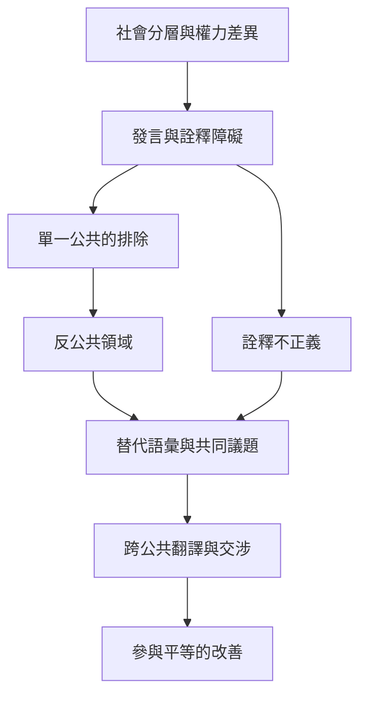

公共領域的民主性取決於不同群體能否定義議題、形成語言並影響公共判斷。形式上「人人都能加入」不足以證明實質平等；需要看誰的經驗被承認、誰能安全出現、誰的語言被視為可信，以及反公共如何連接更大的決策場域。

## 思與行
* 在公共活動前後，檢查參與者是否能改變議題框架，而不只是在既定框架內表達意見。
* 支持群體自主形成語彙，同時建立自願、可撤回且不強迫代表的跨場域連結。

## 概念連結
* [[反公共領域]]、[[次屬反公共領域]]、[[多元公共]]、[[參與平等]]、[[詮釋不正義]]。
* [[單一中立公共空間可能讓優勢群體的語言成為普遍標準]]、[[反公共領域讓受支配群體先形成語言再進入更大公共]]、[[民主討論需修補詮釋不正義而不止保障發言輪次]]。
* 案例：[[女性主義批判指出單一公共領域會複製社會不平等]]、[[印度達利特女性的公共空間經驗揭露種姓化的發言權]]、[[南非媒體轉型未必能消除公共討論中的階級隔離]]。
