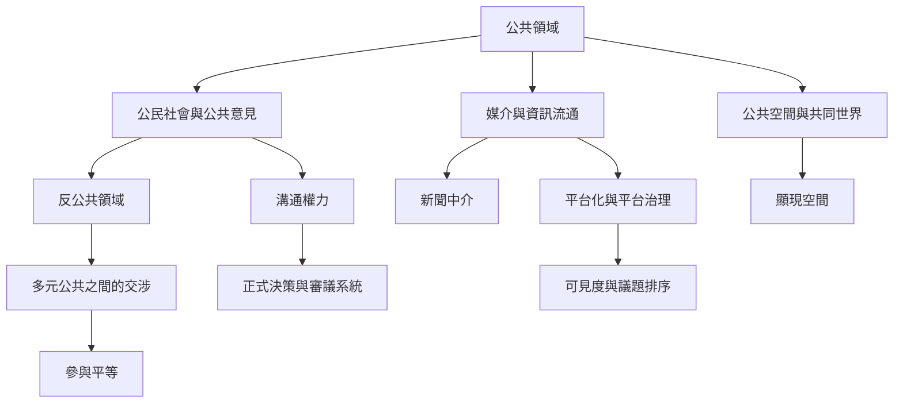

公共領域可理解為一個由公民、媒介、社會組織與政治制度共同構成的溝通系統。它一方面讓共同問題成為可見的公共議題，另一方面需要將公共意見連接到正式決策。分析時，應同時考察場域、傳播、參與平等與制度回應。

## 思與行
* 研究一個案例時，沿著「問題如何被命名—如何傳播—誰能參與—如何進入決策」追蹤。
* 區分公共領域的規範理想、歷史形式與當代制度，不把三者混為一談。

## 概念連結
* [[公共領域]]、[[資產階級公共領域]]、[[公民社會]]、[[公共意見]]、[[溝通權力]]、[[審議民主]]、[[審議系統]]。
* [[公共領域是公民社會向政治系統輸送溝通權力的中介網絡]]、[[公共領域的開放性必須以實質參與平等衡量]]、[[公共討論的品質取決於媒體與議題流通的基礎設施]]。
