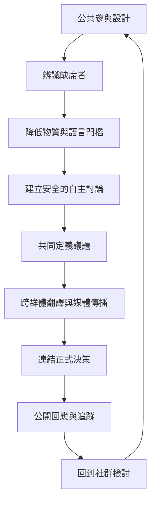

公共領域理論可以轉化成具體設計原則：降低參與成本、容許多種表達形式、讓弱勢群體先建立自己的語彙、維持跨公共的橋接、公開平台治理規則，並確保公民意見能進入正式決策與獲得回應。

## 思與行
* 把公共參與設計成循環，而非一次性活動。
* 將主持、記錄、翻譯、照護與回應追蹤都視為民主基礎工作。

## 概念連結
* [[參與平等]]、[[審議系統]]、[[公共空間]]、[[平台治理]]、[[媒介多元性]]。
* [[用公共領域稽核表檢視一場討論誰未能出席]]、[[讓小型反公共形成保護再搭橋機制]]、[[把公民審議設計成跨場域流程而非單次活動]]、[[為台灣地方議題設計多語言公共聽證]]。
