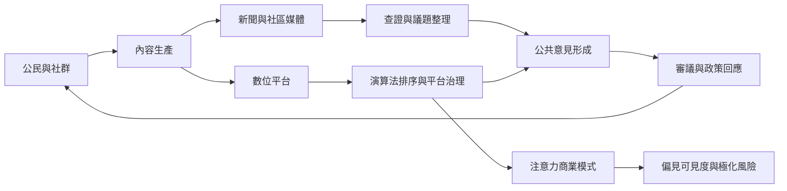

媒介是公共領域的基礎設施，影響議題的可見度、資訊可信度與公眾形成。數位平台擴大了表達入口，卻也把公共資訊流通交給具有商業目標的私人治理系統。評估數位公共領域時，必須同時看使用者互動、平台規則、媒體所有權與制度問責。

## 思與行
* 將媒體素養、獨立新聞、平台透明與公民資料權視為互補條件。
* 追蹤平台規則變動對不同群體的差異影響，並保留替代傳播管道。

## 概念連結
* [[媒介多元性]]、[[新聞中介]]、[[平台化]]、[[平台治理]]、[[網絡化公共]]、[[媒介化社交性]]。
* [[公共討論的品質取決於媒體與議題流通的基礎設施]]、[[平台公共領域的核心問題是私人治理而不只是使用者行為]]、[[媒體多元性需要所有權透明與分散的傳播入口]]。
* 案例：[[數位平台化使注意力商業模式介入公共議題排序]]、[[平台如何借用社群語言卻集中控制公共討論]]、[[非洲互動廣播讓參與者把節目理解成自己能發聲的公共場域]]。
