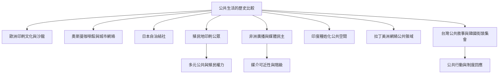

公共領域的歷史並不是單一路徑。歐洲印刷文化與沙龍、奧斯曼咖啡館、日本自治結社、殖民地印刷公眾、南非廣播、拉丁美洲網絡媒體與東亞街頭集會，都呈現不同的公共組織方式。比較時要同時保留共同問題與地方歷史。

## 思與行
* 比較案例時，至少同時記錄媒介、聚會場所、參與者、排除機制與制度回應。
* 優先使用地方研究與當事者材料，避免以英文理論概述取代地方知識。

## 概念連結
* [[殖民公共領域]]、[[多元公共]]、[[跨國公共]]、[[公共空間]]、[[公共性]]。
* [[殖民脈絡要求以多重公共而非單一普遍模型理解現代性]]、[[公共領域的歷史起源包含跨區域流動而非文明單向擴散]]、[[公共領域的地方形式必須由具體歷史與道德語彙理解]]。
* 案例：[[奧斯曼咖啡館提醒公共討論史不能只從歐洲起筆]]、[[日本德川時代的自治結社挑戰公共領域的西方中心論]]、[[台灣疫情敘事呈現自由照護與官僚效率的混合民主文化]]、[[韓國燭光集會把街道轉化為持續的公民公共場域]]。
