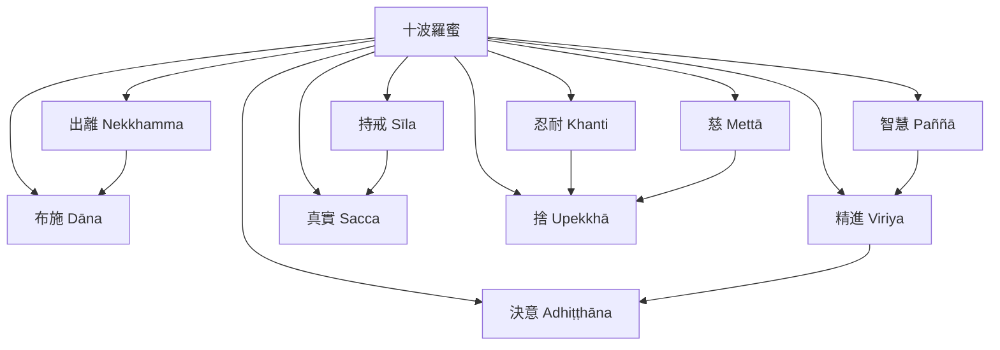

上座部註釋傳統的十波羅蜜包含布施、持戒、出離、智慧、精進、忍耐、真實、決意、慈與捨。可把它理解成一個長期修行網絡：布施與持戒調節人我關係，出離減少欲望束縛，智慧引導判斷，精進與決意支持持續實踐，忍耐、慈與捨則讓行動在逆境與關係中保持穩定。

## 概念連結
- [[Pāramī]]、[[Dāna]]、[[Śīla]]、[[Nekkhamma]]、[[Mettā]]、[[Upekkhā]]。
- [[上座部十波羅蜜與大乘六波羅蜜共享核心卻各有發展]]、[[平等心讓慈悲不被偏愛與排斥綁架]]。
