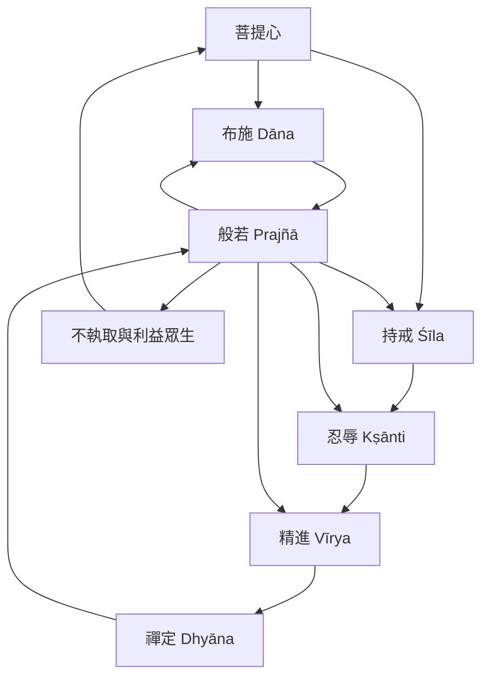

六波羅蜜是大乘菩薩道常見的六項修行德目：布施、持戒、忍辱、精進、禪定與智慧。它們不是六個互不相關的品格，而是彼此支持的實踐系統：倫理讓行動不傷害，耐心減少瞋怒，精進維持投入，禪定穩定注意力，般若則鬆動執取並引導其他德目。

## 概念連結
- [[Pāramitā]]、[[Bodhicitta]]、[[Dāna]]、[[Śīla]]、[[Kṣānti]]、[[Vīrya]]、[[Dhyāna]]、[[Prajñā]]。
- [[智慧使布施不再固著於施者、所施與受者]]、[[般若波羅蜜使六度不落入功德與自我成就的執取]]。
