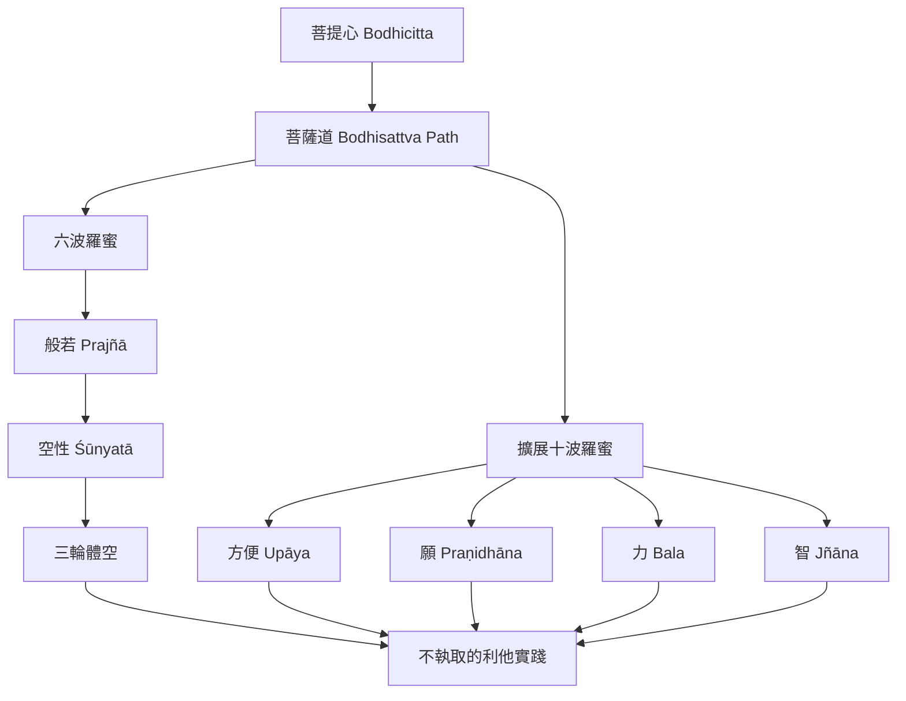

這張概念地圖將大乘修行的方向、方法與觀照放在同一結構中。菩提心提供利他方向；六波羅蜜落實為日常行動；方便與願等擴展德目讓方法因應眾生處境；般若與空性則使修行不被自我、功德與對象的實體化所束縛。

## 概念連結
- [[Bodhicitta]]、[[Bodhisattva]]、[[Pāramitā]]、[[Prajñā]]、[[Śūnyatā]]、[[Upāya]]、[[Praṇidhāna]]、[[Bhūmi]]、[[三輪體空]]。
- [[菩提心使修行德目朝向一切眾生的利益]]、[[大乘十波羅蜜在六項之外加入方便、願、力與智]]。
