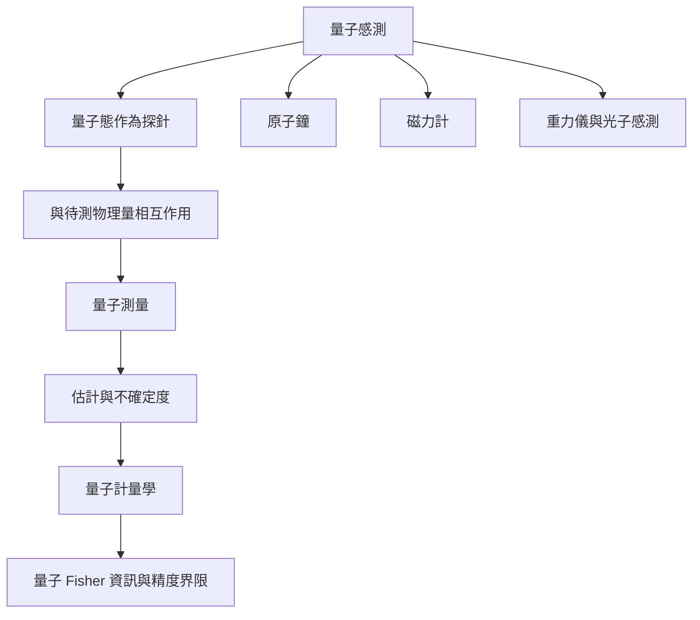

量子感測以受控量子系統作為探針，將磁場、電場、時間、重力或其他物理量編碼到量子態，再透過測量估計。量子計量學研究資源與測量不確定度的基本限制，應用端則須考量噪聲、穩定、校準與部署條件。

核心條目：[[term/量子感測]]、[[term/量子計量學]]、[[term/量子測量]]、[[term/量子態]]、[[term/量子糾纏]]。

重要判斷：[[note/量子感測的應用價值來自任務特定的測量優勢]]。

來源：[[data/量子感測藉由相干疊加與糾纏提升特定測量精度]]、[[data/原子量子感測可跨越從奈米到公尺尺度偵測電磁場]]。

回到：[[moc/量子資訊科學全景地圖]]、[[Quantum_information_science]]。
