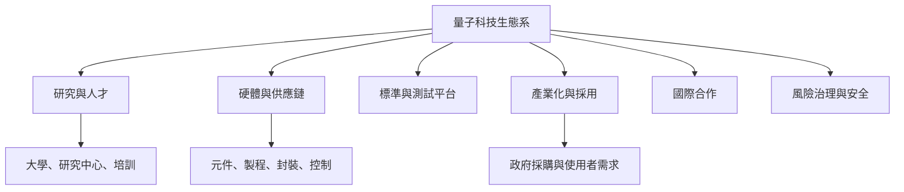

量子技術從研究走向社會應用，需要科研資金、人才、產業鏈、標準、測試平台、國際合作與風險治理。不同國家依既有優勢採取不同路徑，因此應比較生態系的組成與成果，而不是只比政策口號或單一硬體數字。

地區案例：[[data/量子策略從科研投入走向產業生態系競爭]]、[[data/歐盟量子旗艦以四個應用支柱串連科研產業與人才]]、[[data/日本量子策略逐步轉向建構產業生態系]]、[[data/印度國家量子任務同時投資計算通訊與感測]]、[[data/台灣量子躍昇專案強調關鍵零組件與系統整合]]。

重要判斷：[[note/國家量子策略是人才資金供應鏈標準與應用的組合]]。

延伸行動：[[idea/做全球量子生態系比較而非只比量子位元數]]、[[idea/把台灣半導體供應鏈連結到量子系統工程]]。

回到：[[moc/量子資訊科學全景地圖]]、[[Quantum_information_science]]。
