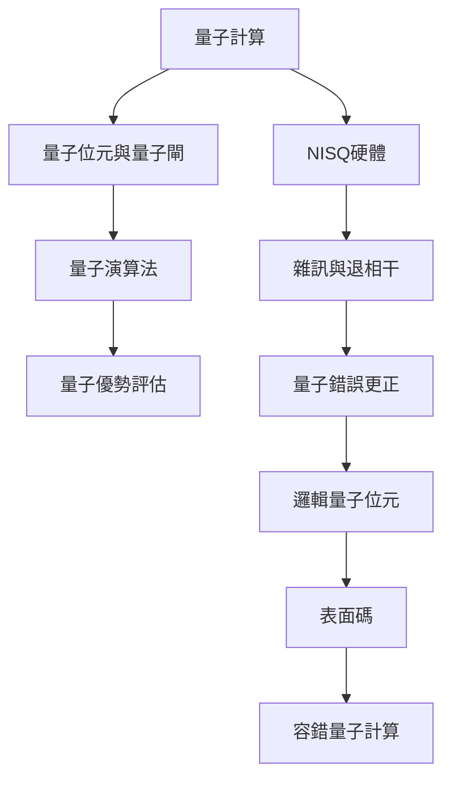

量子計算透過量子閘組合量子態演化，再以測量取得結果。實際裝置會受到雜訊與退相干限制，故可擴展的計算依賴錯誤更正與容錯邏輯操作。

核心條目：[[term/量子位元]]、[[term/量子閘]]、[[term/量子演算法]]、[[term/量子優勢]]、[[term/NISQ]]、[[term/量子錯誤更正]]、[[term/邏輯量子位元]]、[[term/表面碼]]、[[term/容錯量子計算]]。

重要判斷：[[note/量子優勢必須相對於明確的經典基準定義]]、[[note/量子計算的規模化瓶頸在於錯誤控制與系統整合]]、[[note/邏輯量子位元把多個脆弱物理位元組成可靠資訊單位]]、[[note/量子糾錯的成功不等於容錯量子電腦已完成]]。

來源：[[data/NISQ時代的價值是探索而非立即取代經典電腦]]、[[data/表面碼距離增加能壓低邏輯錯誤但仍有系統級瓶頸]]。

回到：[[moc/量子資訊科學全景地圖]]、[[Quantum_information_science]]。
