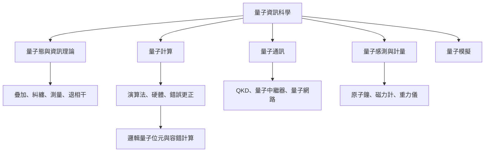

量子資訊科學以量子物理與資訊理論為共同基礎，形成計算、通訊、感測、模擬與理論等互相連結的研究領域。理解時可先掌握共通概念，再依任務分支深入。

**主要概念**：[[term/量子資訊科學]]、[[term/量子位元]]、[[term/量子態]]、[[term/疊加]]、[[term/量子糾纏]]、[[term/量子測量]]、[[term/退相干]]、[[term/密度矩陣]]、[[term/量子通道]]。

**研究主線**：[[moc/量子計算與糾錯概念地圖]]、[[moc/量子通訊與網際網路概念地圖]]、[[moc/量子感測與計量概念地圖]]、[[moc/量子技術治理與全球生態系概念地圖]]。

**永久筆記**：[[note/量子資訊科學是一個橫跨運算通訊感測的研究框架]]、[[note/量子資訊教育需要校準公眾期待與專業不確定性]]。

回到導讀：[[Quantum_information_science]]。
