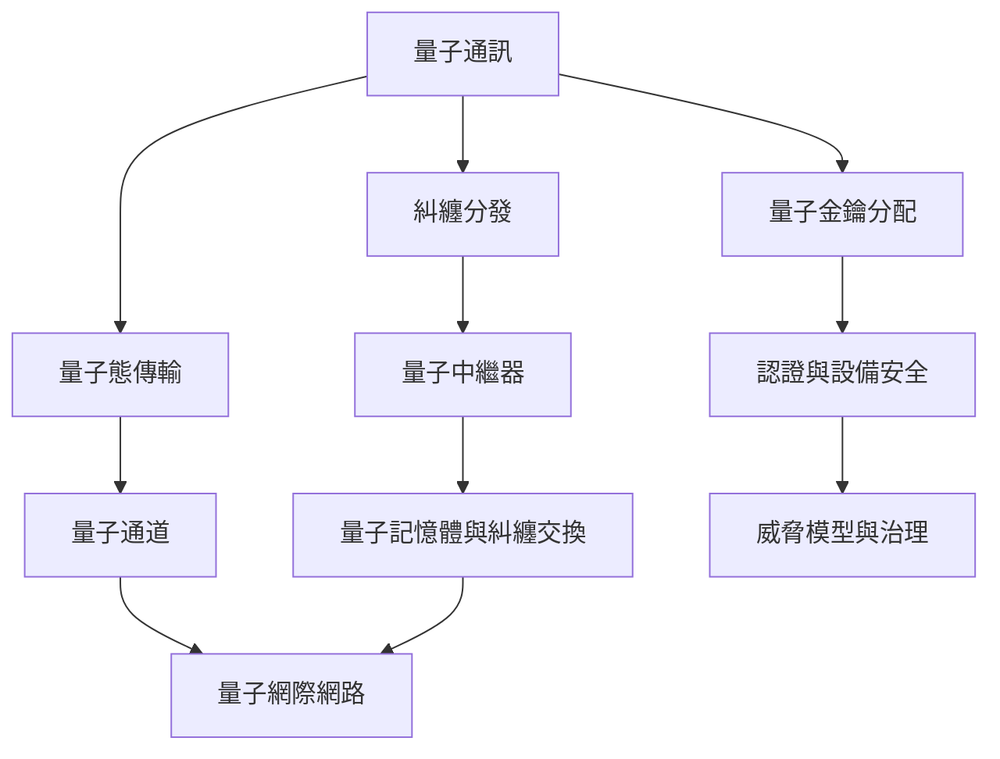

量子通訊的任務包括傳送量子態、分發糾纏與建立密鑰。距離擴展需要量子記憶體、量子中繼器與經典控制通道；量子網際網路可能以專用網路與經典網路混合運作。

核心條目：[[term/量子通訊]]、[[term/量子通道]]、[[term/量子糾纏]]、[[term/量子傳態]]、[[term/量子金鑰分配]]、[[term/量子中繼器]]、[[term/量子網際網路]]、[[term/後量子密碼學]]。

重要判斷：[[note/量子通訊的核心是量子態與糾纏的分發]]、[[note/量子金鑰分配不等同絕對安全的通訊方案]]、[[note/量子中繼器決定量子網路能否跨越距離限制]]。

來源：[[data/量子中繼器是長距量子網路的關鍵基礎設施]]、[[data/衛星量子金鑰分配展示跨千公里量子通訊可行性]]、[[data/實用QKD的安全證明仍需處理理論與實作差距]]。

回到：[[moc/量子資訊科學全景地圖]]、[[Quantum_information_science]]。
