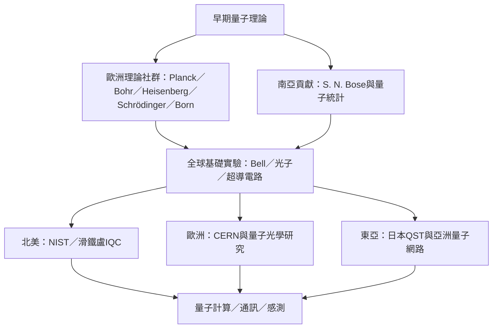

量子力學從歐洲早期理論形成，經由南亞量子統計與全球實驗合作不斷擴展；當代量子研究則由大學、國家研究機構與跨國大型設施共同推進。這張圖鼓勵把知識、人物與機構放在同一張脈絡地圖中。

## 關係圖

## 概念脈絡
[[量子理論的歷史是多地協作而非單一天才的故事]]、[[南亞科學家Bose的統計工作提醒量子史不可只寫成歐洲人物史]]、[[NIST以量子資訊科學連結物理資訊與計量應用]]、[[CERN以量子技術研究補充高能物理的計算感測與通訊]]、[[日本QST把量子材料計算通訊感測與生命科學並列研究]]、[[中國墨子號衛星示範長距離衛星到地面的量子金鑰分發]]

回到全書：[[Quantum_mechanics]]
