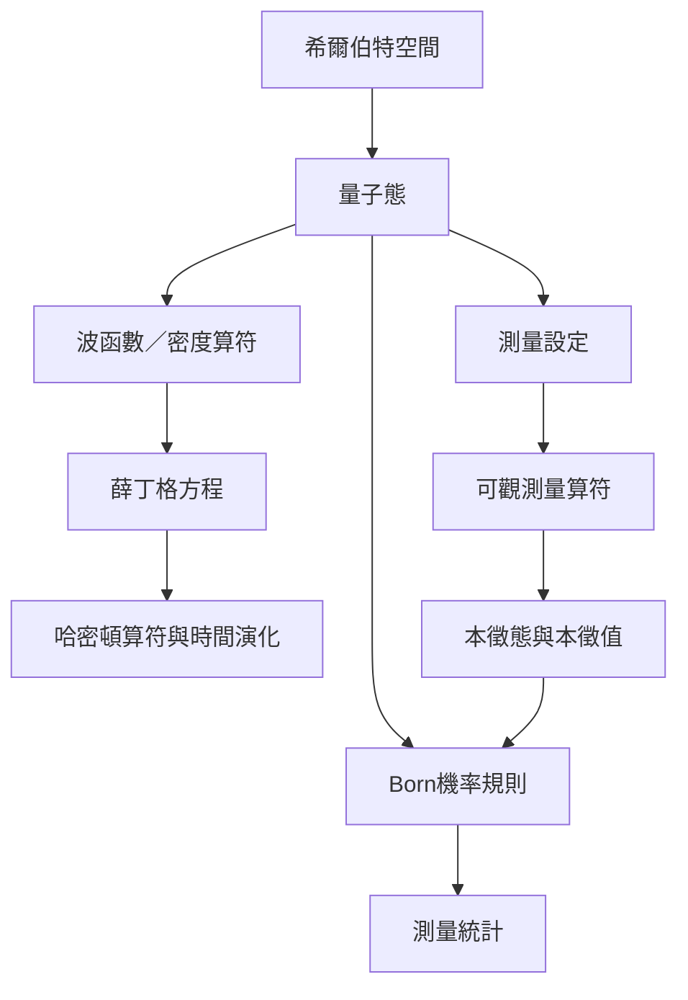

本圖把量子力學的核心數學流程串起來：以狀態表徵系統，透過哈密頓算符演化，再以測量算符與 Born 規則連結到可觀察的統計。閱讀時要區分態的演化與測量結果的機率更新。

## 關係圖

## 概念脈絡
[[希爾伯特空間]]、[[量子態]]、[[波函數]]、[[算符]]、[[薛丁格方程]]、[[Born機率規則]]、[[不對易算符使某些物理量無法同時具有任意精確值]]

回到全書：[[Quantum_mechanics]]
