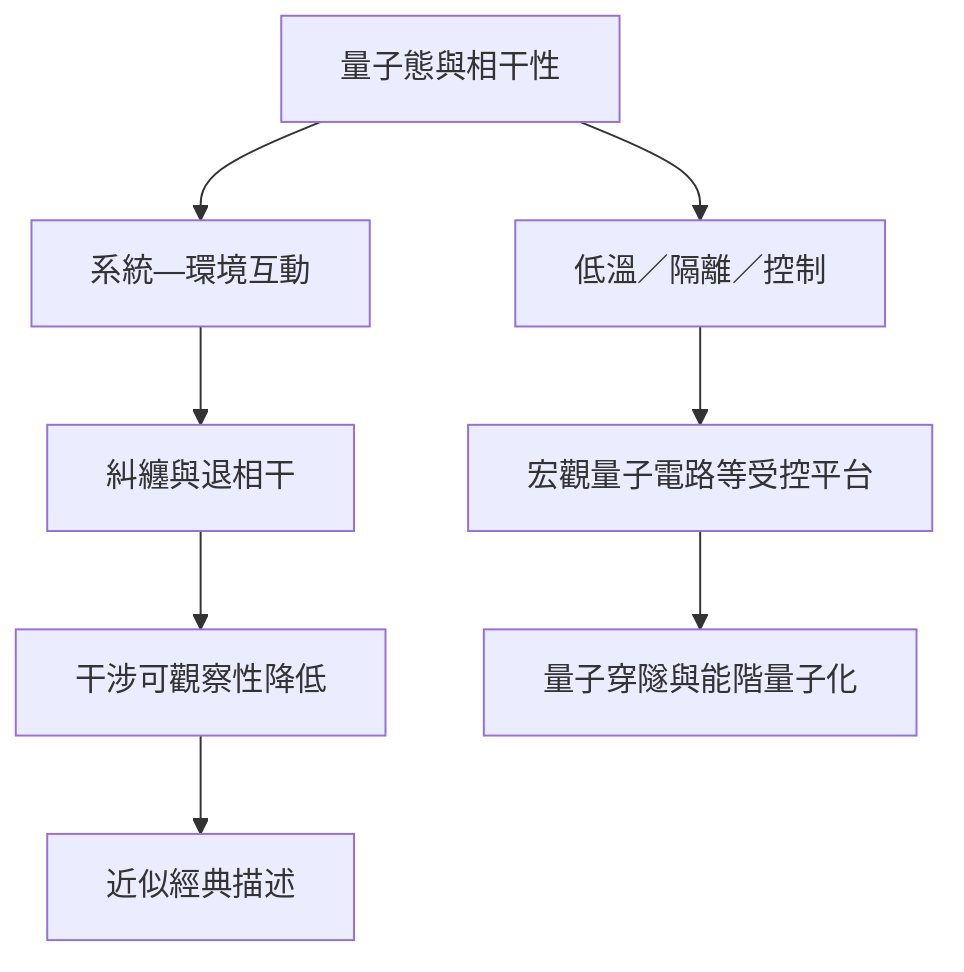

量子—經典轉換不是一條簡單的「微觀變宏觀」界線。系統與環境的互動、相干時間、可控制的集體自由度與觀測尺度，共同決定量子效應能否被觀察。

## 關係圖

## 概念脈絡
[[退相干解釋干涉為何在環境中消失但不等於波函數塌縮]]、[[量子相干性]]、[[量子經典轉換]]、[[量子力學的宏觀效應可以由受控集體自由度呈現]]、[[量子穿隧讓量子態有非零機率出現在經典禁阻區域]]

回到全書：[[Quantum_mechanics]]
