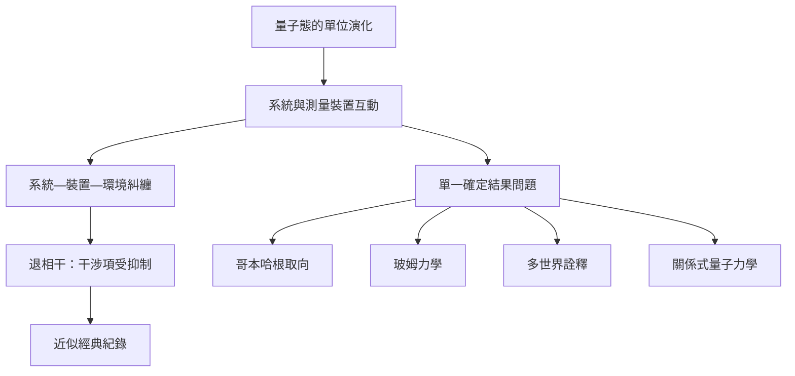

測量問題來自單位演化與確定測量紀錄之間的張力。互補性說明測量配置的角色，退相干說明環境如何壓低可觀察干涉，不同詮釋則對結果唯一性與量子態地位提出不同回答。

## 關係圖

## 概念脈絡
[[測量問題是量子態演化與單一結果之間的落差]]、[[退相干解釋干涉為何在環境中消失但不等於波函數塌縮]]、[[互補性]]、[[哥本哈根詮釋是一組歷史形成且內部不完全一致的觀點]]、[[玻姆力學以導引方程提供決定論的非局域詮釋]]、[[多世界詮釋保留整體波函數的單位演化並重新理解測量結果]]、[[關係式量子力學把量子態理解為系統之間的關係描述]]

回到全書：[[Quantum_mechanics]]
