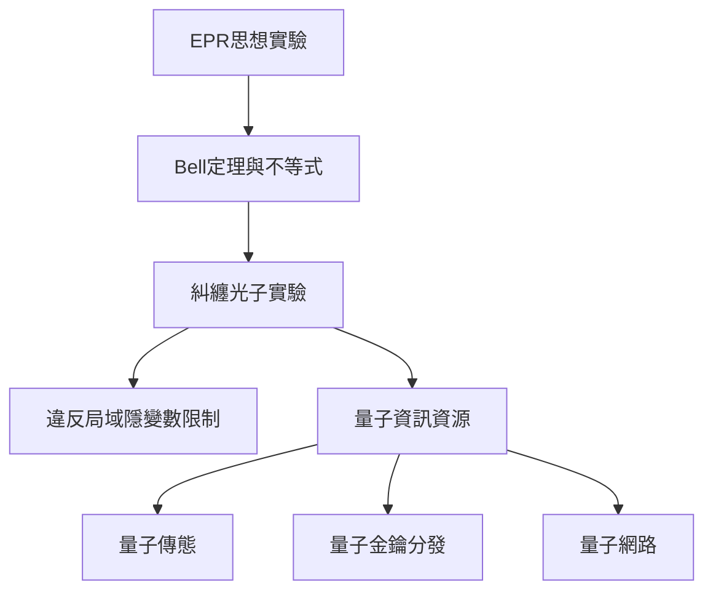

糾纏首先帶來量子理論完整性與局域性問題，Bell 定理把哲學爭論轉成統計限制，實驗則使糾纏成為可驗證的物理資源。相同資源後來又出現在量子傳態、金鑰分發與網路協定。

## 關係圖

## 概念脈絡
[[量子糾纏讓複合系統具有無法拆成局部狀態的相關性]]、[[Bell不等式限制局域隱變數模型]]、[[量子傳態只傳送量子態而非物質]]、[[量子金鑰分發利用量子測量特性建立密鑰]]、[[不可複製定理禁止任意未知量子態的完美複製]]

回到全書：[[Quantum_mechanics]]
