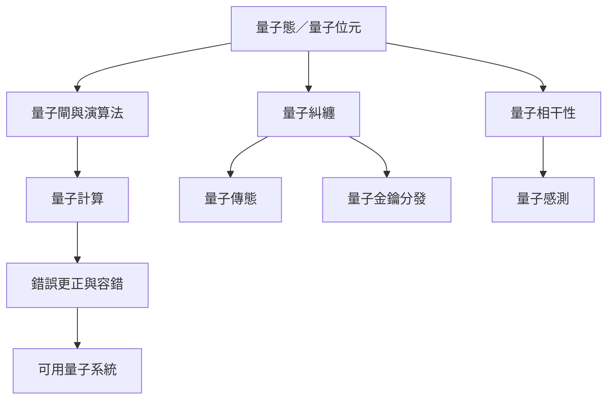

量子資訊的共同基礎是可控制的量子態、量子測量與量子資源。量子計算需要錯誤更正克服雜訊；QKD 需要完整安全模型；量子感測則以量子態提升指定測量任務的性能。

## 關係圖

## 概念脈絡
[[量子資訊]]、[[量子位元]]、[[量子錯誤更正以冗餘編碼抵抗量子雜訊]]、[[量子計算不會讓所有問題都比古典電腦更快]]、[[量子金鑰分發利用量子測量特性建立密鑰]]、[[量子感測]]

回到全書：[[Quantum_mechanics]]
