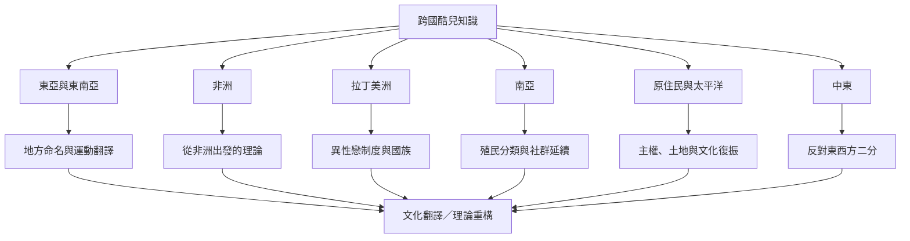

這張地圖把不同地區視為理論生產的位置，而不是歐美理論的案例附錄。比較時要保留語詞、法律、宗教、殖民史與社群組織的差異。

主要連結：[[亞洲酷兒研究應讓亞洲經驗反過來改寫理論]]、[[台灣酷兒運動透過聯盟組裝而不只是身份分類形成政治力量]]、[[非洲酷兒研究必須同時閱讀非洲與從非洲出發的酷兒]]、[[拉丁美洲女同性戀女性主義將異性戀視為政治制度並與國家權力交織]]、[[印度 Hijra 殖民史顯示性別分類由殖民政府與地方菁英共同塑造]]、[[兩靈身份的復振關乎原住民主權而不只是多元性別稱呼]]、[[中東酷兒研究拒絕傳統與現代的東西方二分]]、[[文化翻譯]]、[[酷兒亞洲研究]]、[[Hijra]]、[[Waria]]、[[Two-Spirit]]。

延伸地圖：[[理論核心與知識譜系]]、[[權力制度與交織批判]]。
