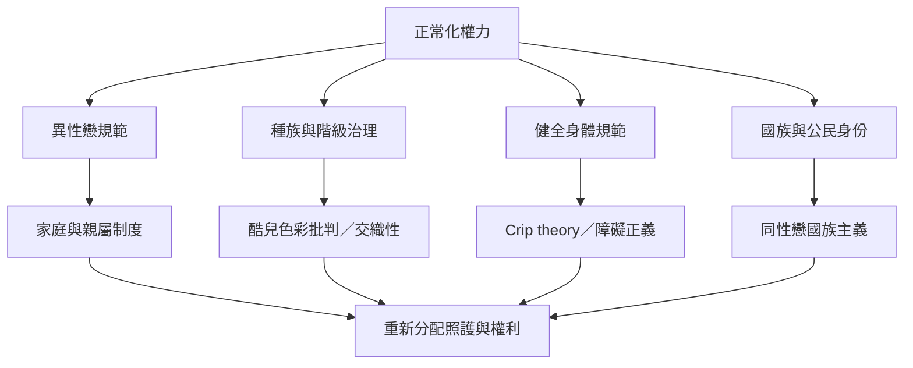

這張地圖聚焦酷兒理論如何分析正常化、國族治理、種族化與障礙化，並將抽象批判轉化成制度與日常設計的問題。

主要連結：[[異性戀規範透過家庭國家法律教育實踐]]、[[黑人酷兒批判將種族階級性與國家治理放在同一分析框架]]、[[身心障礙與酷兒研究交會揭露正常身體的強制性]]、[[同性戀包容也可能成為國族主義與排除機制]]、[[異性戀規範]]、[[酷兒色彩批判]]、[[交織性]]、[[同性戀國族主義]]、[[Crip theory]]。

延伸地圖：[[親屬照護與未來想像]]、[[理論核心與知識譜系]]。
