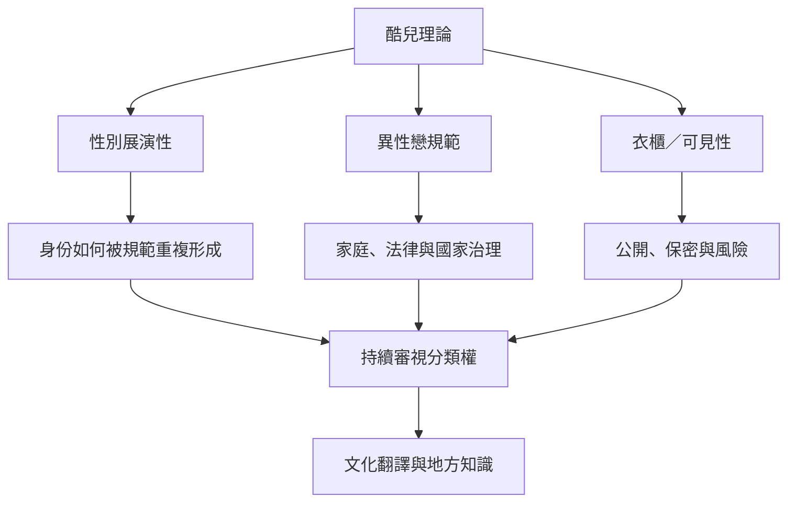

這張概念地圖由理論形成、性別規範、展演性與衣櫃政治出發，連到酷兒理論如何質疑分類，以及這套批判如何延伸至不同地區與知識位置。

主要連結：[[酷兒理論透過質疑規範而非建立新身份分類展開]]、[[性別展演性說明性別如何在重複規範中形成]]、[[衣櫃作為制度揭示可見與不可見如何共同生產性身份]]、[[酷兒理論的批判力量來自持續審視自己的分類權]]、[[異性戀規範]]、[[性別展演性]]、[[衣櫃]]。

延伸地圖：[[地方譜系與去殖民比較]]、[[權力制度與交織批判]]。
