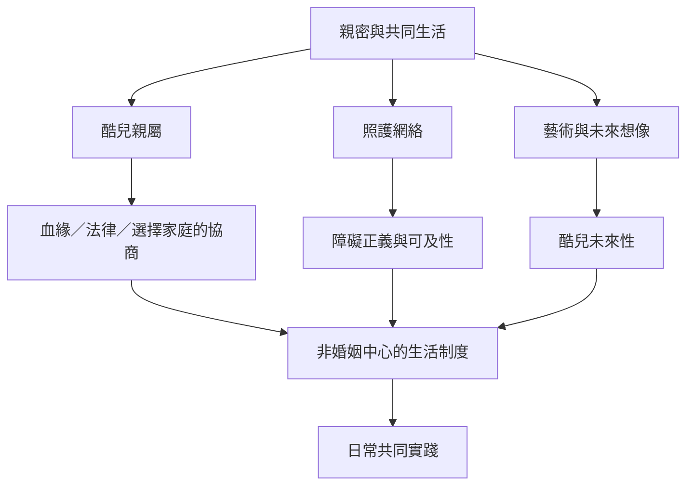

這張地圖從家庭與親屬重新組成出發，連結照護、無障礙實踐與酷兒未來性。它提醒我們，平權不只是取得既有制度資格，也包含共同生活的重新設計。

主要連結：[[酷兒親屬研究顯示家庭可以透過照護與關係實踐重新組成]]、[[酷兒未來性讓政治想像超越眼前的平等政策]]、[[親屬與照護不等同於婚姻制度]]、[[障礙正義拓展酷兒身體政治並要求重新設計共同生活]]、[[酷兒親屬]]、[[酷兒未來性]]、[[Crip theory]]。

行動入口：[[繪製以照護實踐而非法律身份為中心的關係地圖]]、[[把無障礙設計與酷兒友善活動一起規劃]]、[[用藝術與共同生活實驗具體描繪酷兒未來性]]。

延伸地圖：[[權力制度與交織批判]]。
