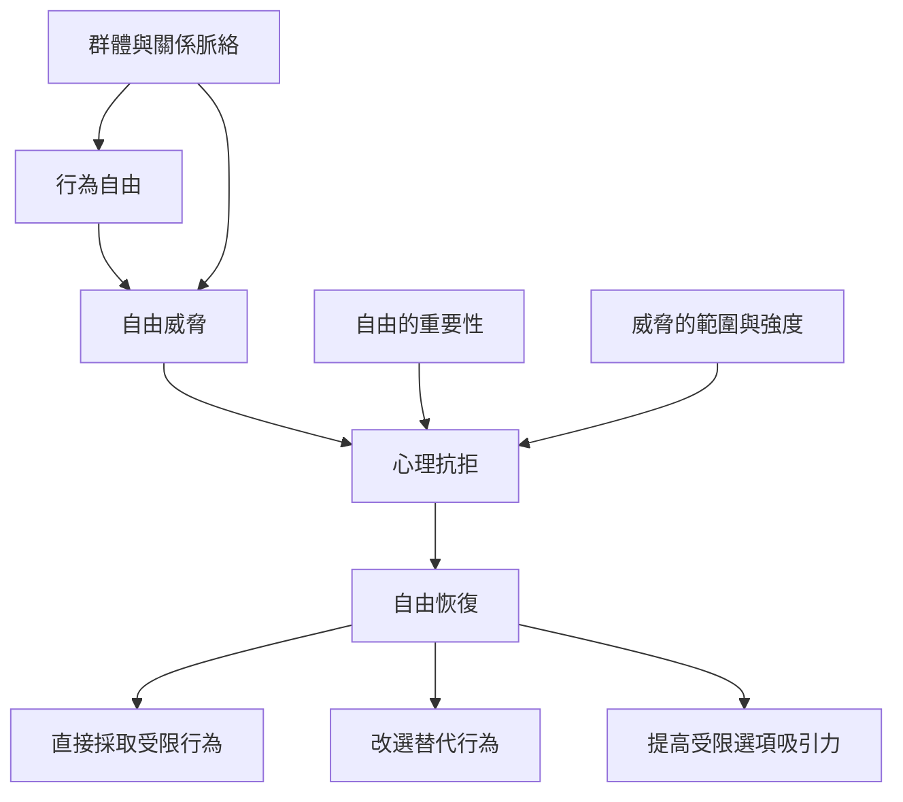

心理抗拒理論將自由受威脅、抗拒動機與自由恢復連成一個解釋框架。讀者可以先理解行為自由的主觀性，再追蹤威脅如何形成心理抗拒，以及個體可能如何直接或間接恢復自由。

核心概念：[[心理抗拒]]、[[心理抗拒理論]]、[[行為自由]]、[[自由威脅]]、[[自由恢復]]。

延伸閱讀：[[心理抗拒是自由受威脅時產生的恢復動機]]、[[自由必須被當事人視為可行且重要才會成為抗拒焦點]]、[[反抗強度取決於自由的重要性與威脅的範圍]]、[[心理抗拒理論將自由受威脅視為反抗動機的起點]]。
