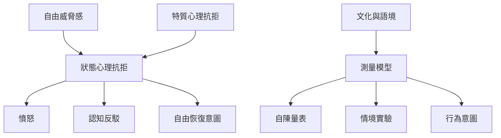

心理抗拒難以直接觀察，研究者通常透過自由威脅感、憤怒、反駁念頭與恢復自由的意圖來理解它。測量時必須區分某一次互動引發的狀態與個體較穩定的特質傾向，也需要留意不同研究的操作定義。

核心概念：[[狀態心理抗拒]]、[[特質心理抗拒]]、[[憤怒]]、[[認知反駁]]、[[心理抗拒]]。

延伸閱讀：[[心理抗拒會透過憤怒與反駁念頭表現出來]]、[[心理抗拒的特質傾向與當下狀態必須分開理解]]、[[測量心理抗拒必須區分特質狀態與一般反對意見]]、[[心理抗拒研究的定義與操作方式仍未完全一致]]。
