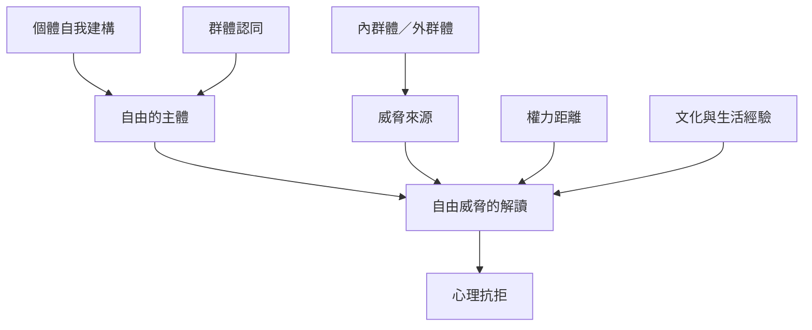

自由不只是在個體內部形成，也受群體歸屬、權力差異與文化情境影響。相同限制由誰提出、誰參與制定、誰承擔後果，會改變限制的意義。跨文化研究尤其需要避免把國籍當成個人心理的替代指標。

核心概念：[[群體認同]]、[[權力距離]]、[[自主性]]、[[心理抗拒]]。

延伸閱讀：[[自由不只屬於個人也可能以群體關係來界定]]、[[台灣與奧地利研究顯示自由威脅的群體來源會改變抗拒]]、[[中美戒菸訊息研究顯示控制語言會引發反彈但文化效果並不單一]]、[[香港反毒訊息研究顯示亞洲受眾不能被假設為不在意自由]]。
