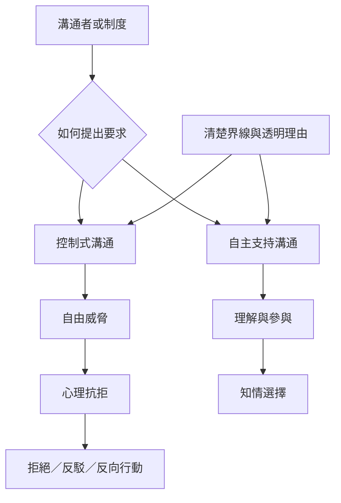

心理抗拒的實務應用，不是消除所有規範，而是減少不必要的自由威脅。自主支持溝通、動機式晤談與參與式規則設計，都嘗試在保留必要界線的同時，增加理解、選擇與合作。

核心概念：[[自主支持溝通]]、[[控制式溝通]]、[[自主性]]、[[動機式晤談]]、[[自我決定理論]]。

延伸閱讀：[[自主支持不是放棄界線而是讓人在界線內保有參與權]]、[[助人關係中的抗拒可以透過合作而非爭辯來回應]]、[[教育中的界線若透明且可討論較不必依賴服從式控制]]、[[高品質溝通要同時尊重選擇與誠實呈現證據]]。
